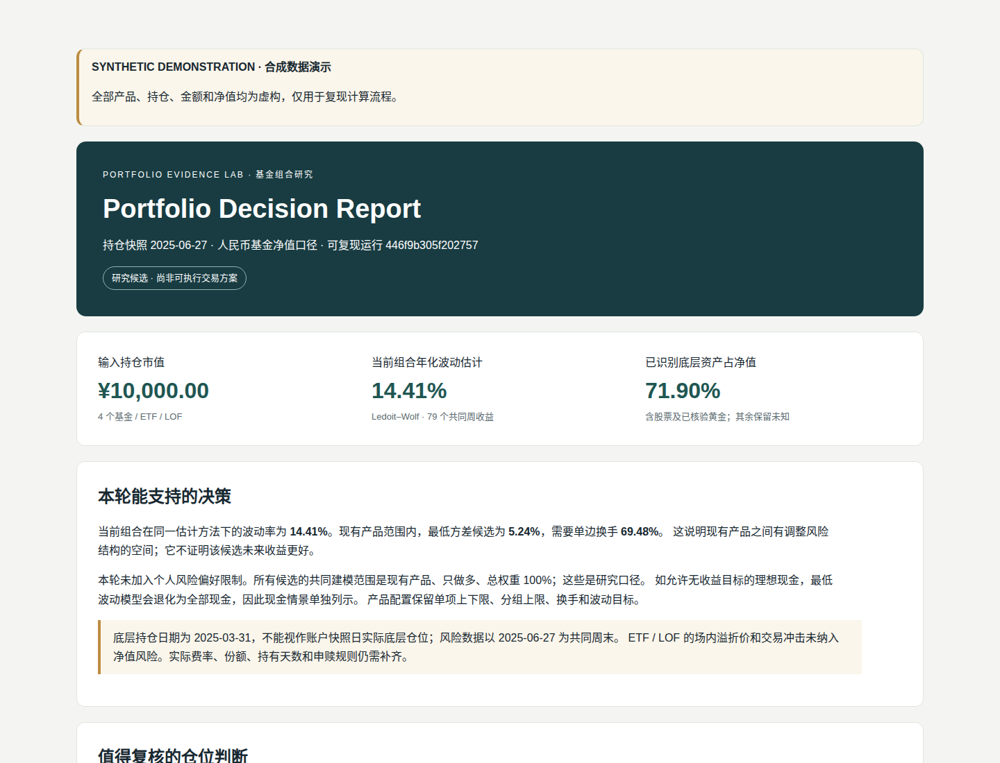
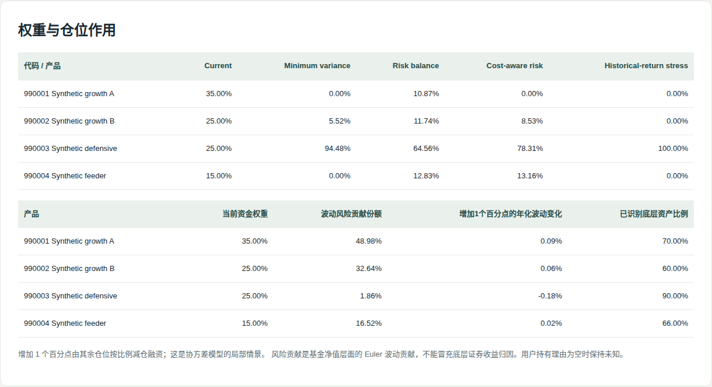

# Portfolio Evidence Lab

[](https://github.com/moonmu687-wq/portfolio-evidence-lab-oss/actions/workflows/ci.yml)
[](pyproject.toml)
[](LICENSE)
[](https://github.com/moonmu687-wq/portfolio-evidence-lab-oss/releases/latest)

Reproducible fund look-through and portfolio risk research.

Know what you own, where your risk comes from, and what the data cannot tell you.

[中文说明](README.zh-CN.md)

## See the report before installing

Download the [standalone HTML report](https://github.com/moonmu687-wq/portfolio-evidence-lab-oss/releases/latest/download/Portfolio_Decision_Report.html) and open it in a browser. Download the [report and CSV bundle](https://github.com/moonmu687-wq/portfolio-evidence-lab-oss/releases/latest/download/synthetic-demo.zip) to use its data links. Reading either report needs no Python installation.



The example identifies 71.9% of underlying NAV and preserves 28.1% as unknown. Fund 990001 has a 35% capital weight but contributes about 49% of estimated volatility risk.



These are captures of the generated report, not a separate interface. All four products, prices, holdings, and amounts are fictional. See [preview details](docs/demo/README.md).

## Try it offline

Use Python 3.12 or later in a virtual environment. From a source checkout:

```sh
python -m pip install -c requirements.lock .
portfolio-lab demo --destination demo-workspace
```

Open the HTML report printed by the command. Running the installed demo needs no account, API key or network connection. Installation requires Python dependencies.

All four products, prices, holdings and amounts are synthetic. The report displays that label and its actual provenance.

| Independently calculable fixture result | Value |
| --- | ---: |
| Identified underlying NAV share | 71.9% |
| Unresolved share | 28.1% |
| Exposure to fictional US:SYNTH_A | 31.15% |

The example includes overlapping equity funds, a defensive fund and a feeder. Unreported assets remain unknown at each recursion level.

## What it does

- Preserves disclosure dates, publication dates, source identifiers and scope.
- Recursively expands funds, detects cycles and reconciles weight totals.
- Reports known overlap and a conservative upper bound for incomplete disclosures.
- Estimates covariance, Euler volatility contributions, drawdown and empirical weekly CVaR.
- Compares constrained research candidates, costs and a chronological holdout.
- Records input/source hashes and content-addressed evidence for replay.

All numbers come from Python calculations. Research candidates are conditional model outputs, not orders or return forecasts.

## Bring local data

```sh
portfolio-lab import-csv positions.csv --output private/ssot/raw.json
portfolio-lab run --root .
```

Also provide a research configuration, CNY total-return NAV observations and normalized holdings. See [input contracts](docs/DATA.md).

## Verify and replay

Replace RUN_ID with the printed run identifier:

```sh
portfolio-lab verify demo-workspace/private/runs/RUN_ID/manifest.json --root demo-workspace
portfolio-lab replay demo-workspace/private/runs/RUN_ID/manifest.json --root demo-workspace --destination replay-workspace
```

Replay requires the recorded Python and dependency versions. It restores saved inputs and source to a new directory. Hash verification detects changes; it does not establish that an original disclosure was accurate.

## Development

```sh
python -m pip install -e ".[dev]"
python -m pytest -q
python -m ruff check src tests scripts
python -m ruff format --check src tests scripts
python -m build
```

Tests exercise mathematical reconciliations, input failures, the production demo path, replay and tamper detection. See [contributing](CONTRIBUTING.md).

CI tests Python 3.12 and 3.13 on Linux and Windows. `scikit-learn` supplies the Ledoit-Wolf estimator used by the risk engine.

## Download a version

[Releases](https://github.com/moonmu687-wq/portfolio-evidence-lab-oss/releases/latest) contain a wheel, source distribution, synthetic report bundle, standalone HTML, and SHA-256 checksums. See the [changelog](CHANGELOG.md) and [maintenance instructions](docs/MAINTENANCE.md). Releases are built from a commit that passed the full quality workflow. PyPI publishing is not configured.

To install a downloaded wheel in a virtual environment:

```sh
python -m pip install portfolio_evidence_lab-0.1.0-py3-none-any.whl
portfolio-lab demo --destination demo-workspace
```

## Privacy and data

Public examples and screenshots use synthetic data or data with documented reuse permission. Source adapters do not grant data access or redistribution rights.

The [source register](docs/DATA_SOURCES.md) records reviewed notices, unresolved permissions, and publication boundaries. The public demo and release generation do not call live adapters.

## Related projects

[QuantStats](https://github.com/ranaroussi/quantstats) provides performance analytics.
[Riskfolio-Lib](https://github.com/dcajasn/Riskfolio-Lib) provides portfolio optimization.
[fund-overlap-lab](https://github.com/JordiCorbilla/fund-overlap-lab) supports fund overlap and recursive expansion.

This project focuses on explicit disclosure gaps and reproducible research evidence. No uniqueness or adoption claim is implied.
